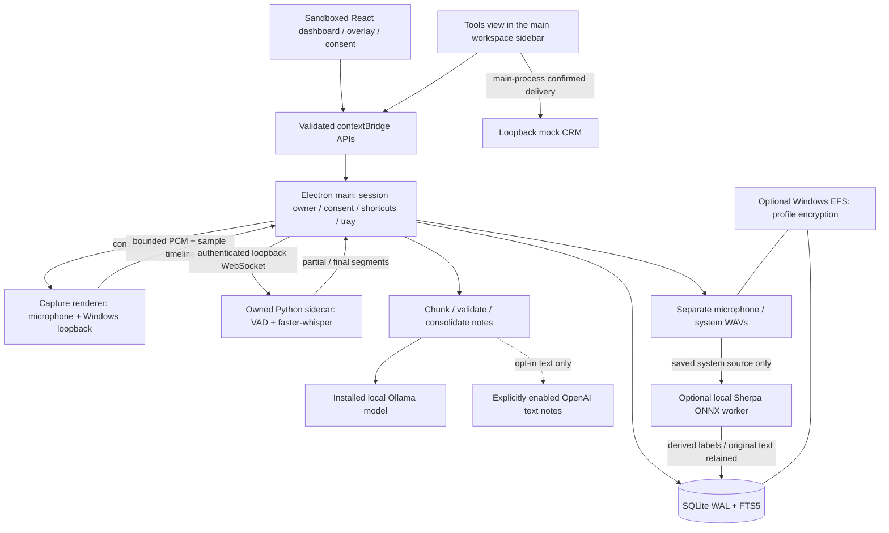

# Vinxa architecture

Implementation reference, 28 November 2026. Current code has not been built or
tested by the agent for this Phase 5 change.

The sidecar binds loopback on an ephemeral port, authenticates with a rotating
per-generation secret, and is owned/reaped by Electron. Capture uses separate
source timelines and bounded IPC; pause/resume preserves session timing. The
recording finishes after durable audio and text finalization. Notes finish in
the background and do not block transcript export.

Main-process IPC validates sender frames and request schemas. Tools IPC accepts
only the main library frame. The capture and overlay renderers are not trusted
to issue tools operations. Destructive operations, CRM and clustering share the
meeting operation lock. Clustering is a bounded child process, cancelled during
shutdown; SQLite closes after pending tools and notes jobs drain.

Bookmarks use the same monotonic session origin as capture. They live in an
additive database migration and are included in exports. Search and exports
resolve derived Remote 1…n labels without modifying original finalized text.
Ask Vinxa performs local FTS retrieval and returns exact excerpts with original
meeting, speaker and timestamp metadata; it does not synthesize unsupported
answers. Lexical matching has no semantic or cross-language recall guarantee.

The default network policy blocks external requests. Local speech, Ollama and
the mock CRM are loopback services. The mock connector additionally restricts
requests to an explicit IPv4 loopback address, port and path, prohibits
redirects, and sends only decisions and actions after a native confirmation.
No production CRM authentication or external endpoint support is implied.

EFS is an operating-system filesystem feature, not SQLCipher or an application
password vault. Conversion runs only after an explicit request and on the next
launch, before SQLite/audio files are opened. Windows owns the user encryption
keys; profile files remain readable to the signed-in account. External exports,
OS memory/page files, screenshots and copies elsewhere are not covered.
